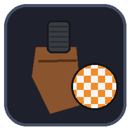

# Holster Zones: move and resize the holster spots on the body in VR

A small desktop window for VR holsters, the sister of [Grip Zones](https://github.com/TefMeister/grip-zones-vr).
**For now it works with one game: Visceral RE8 (Resident Evil Village VR).** Every place on the body where a hand takes
something is a row: the four quick-slot spots (right shoulder, right hip, left hip, left shoulder), the knife, the medicine and
the ammo pouch. Open a row with its arrow and the game shows that spot as an orange-and-white sphere; its sliders move it back /
forward, down / up and left / right, and the four quick-slot spots also have a size (how close the right hand must come). The
row's title says live how far the nearer hand is, and turns green when the hand is inside. **RESET** gives a spot back to the
mod's own place.

**SITTING** moves every holster forward together, by the distance on its slider (30 cm to start with), so they can be reached
from a chair. While the window is closed and SITTING is on, the game marks the spot nearest either hand with a small sphere.

Made 2026-11-14 for playing seated: Window View hangs this window in VR, the same way as Hand Poser and Grip Zones. Ticked
sliders step with the controller through Window View (X −1, Y −5, A +1, B +5); the − and + buttons step half a centimetre.

## Get it

**Download:** [HolsterZones-v1.3.zip](https://github.com/TefMeister/holster-zones-vr/releases/download/v1.3/HolsterZones-v1.3.zip)
(v1.3, 2026-11-18; check it against `SHA256SUMS.txt` on the [release page](https://github.com/TefMeister/holster-zones-vr/releases/tag/v1.3)).
Unzip, right-click `install.ps1`, choose **Run with PowerShell**; no administrator rights needed. Tested: the built-in
self-test, 13 checks, all pass (2026-11-18); the ammo pouch's size slider (new in v1.3) has not been used in a headset yet.
Lanes can install it for you too.

Or build it yourself: `build.bat` (only the C# compiler that ships with Windows), then
`dist\HolsterZones.exe --selftest build\selftest` (no game needed), then `install.ps1` (right-click, **Run with PowerShell**).
A **Holster Zones** icon appears on the desktop; no administrator rights are needed. The game half (the holster script that
reads the window's file and draws the sphere) is part of Visceral RE8 itself; without it the window opens but has nothing to move.

## How it talks to the game

Three small files in the game's `reframework\data\visceral_re8\` folder: `holster_zones.json` (written here: SITTING and each
spot's move and size, in metres), `holster_zones_open.json` (written here: the open row), `holster_zones_state.json` (written
by the game four times a second: how far the hands are from each spot). Details at the top of `app/HolsterFile.cs`.

## Credits

The knife, medicine and ammo holsters are Andyalpa's, from the RE8 VR work this mod builds on; the quick-slot spots are
Visceral RE8's own. The window parts (sliders, skin, controller buttons) are shared with Grip Zones and Hand Poser. If you
should be credited here and are not, please open an issue.

MIT licence.

## The SITTING switch from outside the window (2026-11-23)

A session with nobody at the mouse writes `reframework/data/visceral_re8/holster_remote.json` in the game folder: `{"seq": 3, "sitting": false, "fwd": 0.30}` (a new `seq` each time; `fwd` in metres is optional). The window sets its switch as if it had been clicked and answers in `holster_remote_done.json`. `[verified-live 2026-11-23, n=1: switched off, the game file followed]`
